<!-- LeanBitLab GitHub Profile README -->

### Build lean. Build right.

**Crafting bloat-free, efficient Android and Linux experiences.**

  <a href="https://leanbitlab.github.io/">
    <picture><source media="(prefers-color-scheme: dark)" srcset="./badges/website-dark.svg"></picture>
  </a>
  &nbsp;&nbsp;
  <a href="https://github.com/LeanBitLab#%EF%B8%8F-support-us">
    <picture><source media="(prefers-color-scheme: dark)" srcset="./badges/sponsor-us-dark.svg"></picture>
  </a>

<!-- GitHub Stats with combined stats from all repos -->
<a href="https://github.com/LeanBitLab">
  <picture><source media="(prefers-color-scheme: dark)" srcset="./stats-dark.svg">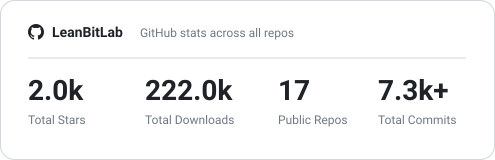</picture>
</a>

  <a href="#-android-apps">Apps</a> &nbsp;&middot;&nbsp;
  <a href="#-leantype-plugins">Plugins</a> &nbsp;&middot;&nbsp;
  <a href="#-other-projects">Other</a> &nbsp;&middot;&nbsp;
  <a href="#%EF%B8%8F-support-us">Support</a> &nbsp;&middot;&nbsp;
  <a href="#-get-in-touch">Community</a>

---

## 💡 Why LeanBitLab

Open-source Android and Linux software that respects your device and your data.

- **Free forever**: no paywalls, "pro" tiers, subscriptions or in-app purchases.
- **Private by design**: no telemetry, tracking or background drain.
- **Lean**: small, fast, and focused on doing one job well.
- **Community sustained**: independent, funded only by voluntary sponsorships.

 

  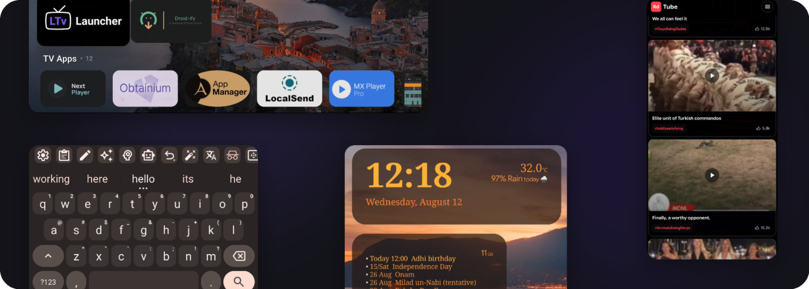

---

## 📱 Android Apps

<table>
  <thead>
    <tr>
      <th width="28%" align="left">Project</th>
      <th width="42%" align="left">Description</th>
      <th width="30%" align="left">Stats &amp; Status</th>
    </tr>
  </thead>
  <tbody>
    <tr>
      <td><b><a href="https://github.com/LeanBitLab/LeanType">⌨️ LeanType</a></b></td>
      <td>Privacy-first Android keyboard with multi-provider AI proofreading, offline voice typing, OCR, and deep customization</td>
      <td>
        <a href="https://github.com/LeanBitLab/LeanType/releases/latest"><picture><source media="(prefers-color-scheme: dark)" srcset="./badges/leantype-dark.svg">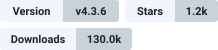</picture></a>
      </td>
    </tr>
    <tr>
      <td><b><a href="https://github.com/leanbitlab-org/LtvLauncher">📺 LTvLauncher</a></b></td>
      <td>Fast, ad-free Android TV launcher with D-pad navigation, custom categories, widgets and OLED screensaver</td>
      <td>
        <a href="https://github.com/leanbitlab-org/LtvLauncher/releases/latest"><picture><source media="(prefers-color-scheme: dark)" srcset="./badges/ltvlauncher-dark.svg">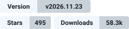</picture></a>
      </td>
    </tr>
    <tr>
      <td><b><a href="https://github.com/LeanBitLab/Lwidget">📊 Lwidget</a></b></td>
      <td>Offline Material You widget for system stats, steps, calendar, tasks and weather, with no network permission</td>
      <td>
        <a href="https://github.com/LeanBitLab/Lwidget/releases/latest"><picture><source media="(prefers-color-scheme: dark)" srcset="./badges/lwidget-dark.svg">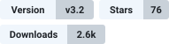</picture></a>
      </td>
    </tr>
    <tr>
      <td><b><a href="https://github.com/LeanBitLab/RdTube">🎬 RdTube</a></b></td>
      <td>Private Reddit video client with a Shorts-style feed, pure OLED theme and zero tracking</td>
      <td>
        <a href="https://github.com/LeanBitLab/RdTube/releases/latest"><picture><source media="(prefers-color-scheme: dark)" srcset="./badges/rdtube-dark.svg">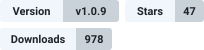</picture></a>
      </td>
    </tr>
  </tbody>
</table>

---

## 🔌 LeanType Plugins

Optional add-ons that keep the LeanType core lean. Install only the ones you need.

<table>
  <thead>
    <tr>
      <th width="28%" align="left">Project</th>
      <th width="42%" align="left">Description</th>
      <th width="30%" align="left">Stats &amp; Status</th>
    </tr>
  </thead>
  <tbody>
    <tr>
      <td><b><a href="https://github.com/LeanBitLab/Leantype-Handwriting-Plugin">✍️ Handwriting Plugin</a></b></td>
      <td>On-device handwriting recognition layout plugin for LeanType supporting 300+ languages via Google ML Kit</td>
      <td>
        <a href="https://github.com/LeanBitLab/Leantype-Handwriting-Plugin/releases/latest"><picture><source media="(prefers-color-scheme: dark)" srcset="./badges/leantype-handwriting-plugin-dark.svg"></picture></a>
      </td>
    </tr>
    <tr>
      <td><b><a href="https://github.com/LeanBitLab/Leantype-Translation-Plugin">🌐 Translation Plugin</a></b></td>
      <td>100% on-device offline translation plugin for LeanType supporting 59+ languages powered by ML Kit</td>
      <td>
        <a href="https://github.com/LeanBitLab/Leantype-Translation-Plugin/releases/latest"><picture><source media="(prefers-color-scheme: dark)" srcset="./badges/leantype-translation-plugin-dark.svg">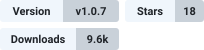</picture></a>
      </td>
    </tr>
    <tr>
      <td><b><a href="https://github.com/LeanBitLab/LeanType-Voice-Plugin">🎙️ Voice Plugin</a></b></td>
      <td>Fast, offline on-device speech-to-text voice typing plugin for LeanType powered by whisper.cpp and ARM NEON</td>
      <td>
        <a href="https://github.com/LeanBitLab/LeanType-Voice-Plugin/releases/latest"><picture><source media="(prefers-color-scheme: dark)" srcset="./badges/leantype-voice-plugin-dark.svg"></picture></a>
      </td>
    </tr>
    <tr>
      <td><b><a href="https://github.com/LeanBitLab/leantype-whisper-models">🗣️ Whisper Models</a></b></td>
      <td>Official Q5_1 Whisper models (tiny, base, small) for LeanType voice typing, with verified SHA-256 checksums</td>
      <td>
        <a href="https://github.com/LeanBitLab/leantype-whisper-models/releases/latest"><picture><source media="(prefers-color-scheme: dark)" srcset="./badges/leantype-whisper-models-dark.svg">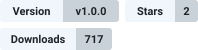</picture></a>
      </td>
    </tr>
    <tr>
      <td><b><a href="https://github.com/LeanBitLab/LeanType-Offline-AI-Plugin">🤖 Offline AI Plugin</a></b></td>
      <td>100% on-device neural proofreading and local LLM plugin for LeanType powered by llama.cpp and local GGUF models</td>
      <td>
        <a href="https://github.com/LeanBitLab/LeanType-Offline-AI-Plugin/releases/latest"><picture><source media="(prefers-color-scheme: dark)" srcset="./badges/leantype-offline-ai-plugin-dark.svg"></picture></a>
      </td>
    </tr>
    <tr>
      <td><b><a href="https://github.com/LeanBitLab/LeanType-OCR-Plugin">🔍 OCR Plugin</a></b></td>
      <td>Offline on-device Optical Character Recognition (OCR) plugin for LeanType supporting Latin, CJK, and Devanagari scripts</td>
      <td>
        <a href="https://github.com/LeanBitLab/LeanType-OCR-Plugin/releases/latest"><picture><source media="(prefers-color-scheme: dark)" srcset="./badges/leantype-ocr-plugin-dark.svg"></picture></a>
      </td>
    </tr>
    <tr>
      <td><b><a href="https://github.com/LeanBitLab/LeanType-CJK-Plugin">🀄 CJK Plugin</a></b></td>
      <td>Standalone Chinese (Pinyin) and Japanese (romaji to kana to kanji) input companion plugin for LeanType, fully offline</td>
      <td>
        <a href="https://github.com/LeanBitLab/LeanType-CJK-Plugin/releases/latest"><picture><source media="(prefers-color-scheme: dark)" srcset="./badges/leantype-cjk-plugin-dark.svg"></picture></a>
      </td>
    </tr>
    <tr>
      <td><b><a href="https://github.com/LeanBitLab/LeanType-Gif-Plugin">🎞️ GIF Plugin</a></b></td>
      <td>GIF, sticker and meme search for LeanType (GIPHY, KLIPY and local media)</td>
      <td>
        <a href="https://github.com/LeanBitLab/LeanType-Gif-Plugin/releases/latest"><picture><source media="(prefers-color-scheme: dark)" srcset="./badges/leantype-gif-plugin-dark.svg"></picture></a>
      </td>
    </tr>
    <tr>
      <td><b><a href="https://github.com/LeanBitLab/LeanType-SoundPacks">🔊 Sound Packs</a></b></td>
      <td>Curated low-latency keyboard sound packs and a custom pack creator guide for LeanType</td>
      <td>
        <a href="https://github.com/LeanBitLab/LeanType-SoundPacks/"><picture><source media="(prefers-color-scheme: dark)" srcset="./badges/leantype-soundpacks-dark.svg">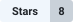</picture></a>
      </td>
    </tr>
    <tr>
      <td><b><a href="https://github.com/LeanBitLab/LeanType-Language-Packs">🌐 Language Packs</a></b></td>
      <td>Downloadable UI translations for the English-only (lite) LeanType builds (Android 11+)</td>
      <td>
        <a href="https://github.com/LeanBitLab/LeanType-Language-Packs/releases/latest"><picture><source media="(prefers-color-scheme: dark)" srcset="./badges/leantype-language-packs-dark.svg">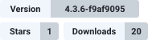</picture></a>
      </td>
    </tr>
  </tbody>
</table>

---

## 💻 Other Projects

<table>
  <thead>
    <tr>
      <th width="28%" align="left">Project</th>
      <th width="42%" align="left">Description</th>
      <th width="30%" align="left">Stats &amp; Status</th>
    </tr>
  </thead>
  <tbody>
    <tr>
      <td><b><a href="https://github.com/LeanBitLab/adaptive-brightness-linux">💡 Adaptive Brightness Linux</a></b></td>
      <td>Rust auto-brightness daemon and TUI for Linux: ALS curves, DDC/CI monitor control, adaptive learning</td>
      <td>
        <a href="https://github.com/LeanBitLab/adaptive-brightness-linux/releases/latest"><picture><source media="(prefers-color-scheme: dark)" srcset="./badges/adaptive-brightness-linux-dark.svg">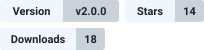</picture></a>
      </td>
    </tr>
  </tbody>
</table>

---

## 🚧 In Development

<table>
  <thead>
    <tr>
      <th width="28%" align="left">Project</th>
      <th width="42%" align="left">Description</th>
      <th width="30%" align="left">Stats &amp; Status</th>
    </tr>
  </thead>
  <tbody>
    <tr>
      <td><b>📝 LeanBook</b></td>
      <td>Notes, Tasks, Reminders, Bills &amp; Shopping list</td>
      <td>
        <picture><source media="(prefers-color-scheme: dark)" srcset="./badges/status-in-development-dark.svg">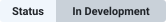</picture>
      </td>
    </tr>
    <tr>
      <td><b>📞 Minimal Dialer</b></td>
      <td>Clean, bloat-free phone dialer</td>
      <td>
        <picture><source media="(prefers-color-scheme: dark)" srcset="./badges/status-in-development-dark.svg"></picture>
      </td>
    </tr>
  </tbody>
</table>

---

## ❤️ Support Us

Because our apps are 100% free with no paywalls, premium tiers, or ads, your support is what helps us maintain our current projects and develop new bloat-free experiences.

  
  &nbsp;
  

### 💖 GitHub Sponsors

Thank you to our amazing sponsors!

<!-- SPONSORS_LIST:START -->

  <strong><a href="https://github.com/wshrguy">wshrguy</a></strong> &nbsp;&bull;&nbsp;
  <strong><a href="https://github.com/BeppeBoppo">BeppeBoppo</a></strong> &nbsp;&bull;&nbsp;
  <strong><a href="https://github.com/as3droid">as3droid</a></strong> &nbsp;&bull;&nbsp;
  <strong><a href="https://github.com/SRGWML">SRGWML</a></strong> &nbsp;&bull;&nbsp;
  <strong><a href="https://github.com/adven2rer">adven2rer</a></strong> &nbsp;&bull;&nbsp;
  <strong><a href="https://github.com/jimmietron">jimmietron</a></strong> &nbsp;&bull;&nbsp;
  <strong><a href="https://github.com/Redoregon">Redoregon</a></strong> &nbsp;&bull;&nbsp;
  <strong><a href="https://github.com/VinVel">VinVel</a></strong> &nbsp;&bull;&nbsp;
  <strong>Johan Marten</strong> &nbsp;&bull;&nbsp;
  <strong><a href="https://github.com/BareTread">BareTread</a></strong> &nbsp;&bull;&nbsp;
  <strong><a href="https://github.com/spielist">spielist</a></strong> &nbsp;&bull;&nbsp;
  <strong><a href="https://github.com/mtg92">mtg92</a></strong> &nbsp;&bull;&nbsp;
  <strong><a href="https://github.com/sergio-asenjo">sergio-asenjo</a></strong> &nbsp;&bull;&nbsp;
  <strong><a href="https://github.com/PareTrast">PareTrast</a></strong> &nbsp;&bull;&nbsp;
  <strong><a href="https://github.com/kaoneko">kaoneko</a></strong> &nbsp;&bull;&nbsp;
  <strong><a href="https://github.com/frostynumeral">frostynumeral</a></strong> &nbsp;&bull;&nbsp;
  <strong><a href="https://github.com/thewalkingcat">thewalkingcat</a></strong> &nbsp;&bull;&nbsp;
  <strong><a href="https://github.com/jurag9999">jurag9999</a></strong> &nbsp;&bull;&nbsp;
  <strong>q****t</strong> &nbsp;&bull;&nbsp;
  <strong><a href="https://github.com/StroopyDoo">StroopyDoo</a></strong> &nbsp;&bull;&nbsp;
  <strong><a href="https://github.com/slim71km-hub">slim71km-hub</a></strong> &nbsp;&bull;&nbsp;
  <strong><a href="https://github.com/jont4">jont4</a></strong> &nbsp;&bull;&nbsp;
  <strong><a href="https://github.com/4di-hello">4di-hello</a></strong> &nbsp;&bull;&nbsp;
  <strong><a href="https://github.com/kris3p">kris3p</a></strong> &nbsp;&bull;&nbsp;
  <strong><a href="https://github.com/rupo49">rupo49</a></strong> &nbsp;&bull;&nbsp;
  <strong><a href="https://github.com/ZT-ke">ZT-ke</a></strong> &nbsp;&bull;&nbsp;
  <strong><a href="https://github.com/repoapks">repoapks</a></strong>

<!-- SPONSORS_LIST:END -->

---

## 📫 Get In Touch

  
  &nbsp;
  
  &nbsp;
  
  &nbsp;
  
  &nbsp;
  <a href="https://x.com/LeanBitLab"><picture><source media="(prefers-color-scheme: dark)" srcset="./badges/social-x-dark.svg"></picture></a>

---

  <b>Open Source • Privacy Focused • Bloat Free</b>

